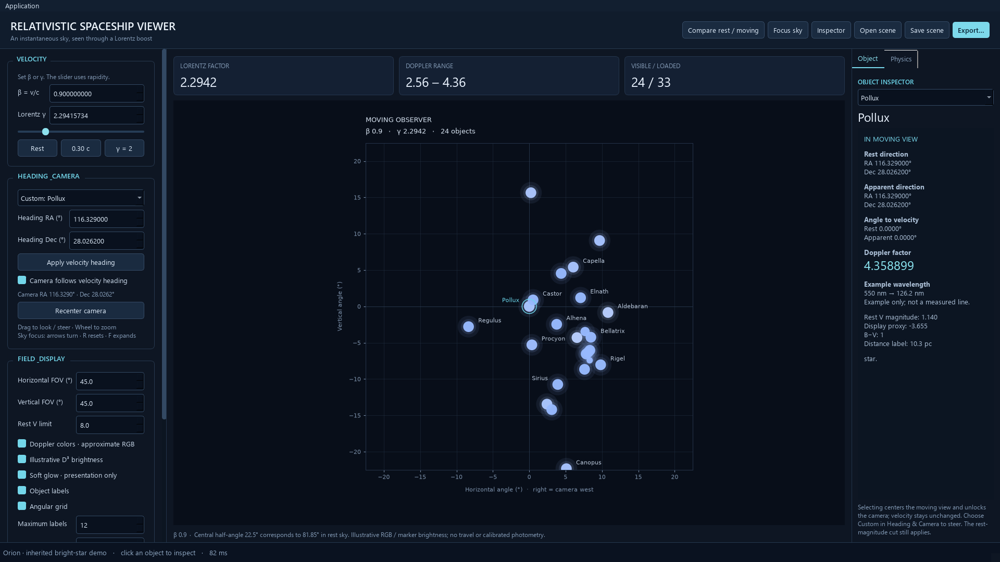
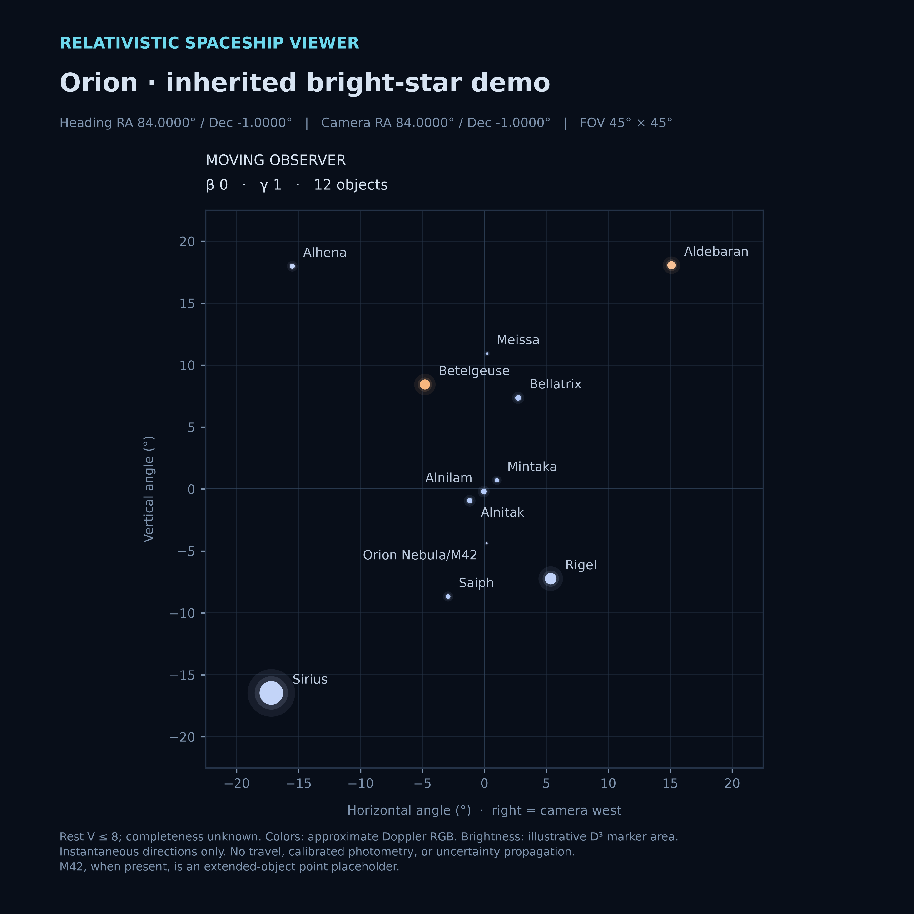
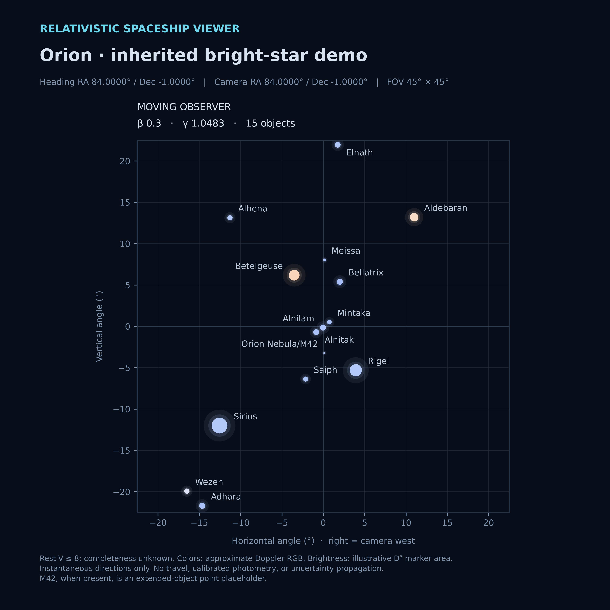
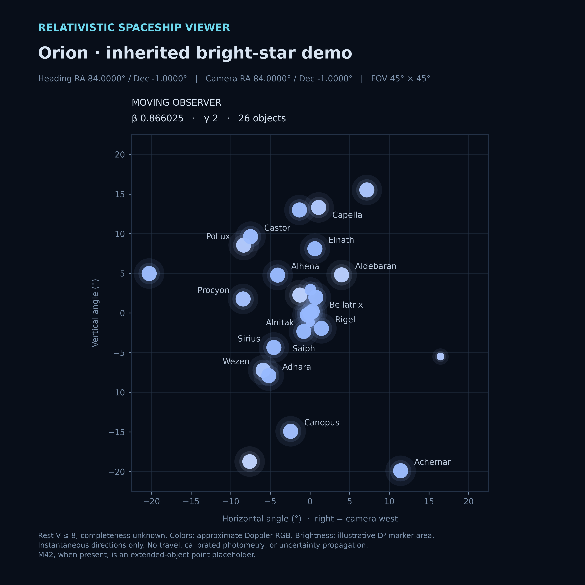

# Relativistic Spaceship Viewer

Explore the instantaneous apparent sky of an observer moving at a significant
fraction of the speed of light. Aberration changes the directions; the Doppler
factor changes the frequency. The physics stays visible alongside the view.

**0.2.2 — local release candidate, unpublished.** The Qt interface, reproducible
exports, Windows installer, and managed updater are implemented. The prepared
Windows binaries are unsigned; no GitHub release has been published.



## Explore

- Set speed as **β = v/c** or **Lorentz γ**; use presets for rest, 0.30 c, or
  exactly γ = 2. The slider uses rapidity for useful control near c.
- Choose Orion, the Galactic Center, Tau Ceti, or a custom velocity heading.
- Lock the camera to the velocity heading to steer, or unlock it to look around
  without changing the boost. Drag the sky, use the wheel to zoom, or use arrow
  keys while the sky has keyboard focus.
- Compare synchronized **rest and moving** views. FOV, camera, catalog, and
  selection settings are shared. **Focus sky** hides the side panels.
- Click a source to inspect its rest/apparent coordinates, angle to the velocity
  heading, Doppler factor, and a clearly labeled 550 nm wavelength example.
  Selection centers its apparent direction without steering. Choose
  **Custom: [object]** in the heading presets to steer explicitly.
- The inspector dropdown keeps the original 33 named targets even with the
  full Hipparcos sky loaded. Individual catalog sources remain clickable.
- **Focus sky** provides a 16:9 angular viewport with equal angular scales;
  visibility is recomputed, and leaving focus restores the previous FOV.
- Import an explicitly labeled CSV catalog or optionally fetch Hipparcos.
  Imports show units, rejected rows, and a preview before applying the catalog.
- Save a portable JSON scene, or export PNG, SVG, PDF, numeric arrays, and a
  complete scene snapshot into a new versioned folder.

The Tau Ceti preset retains the original *Project Hail Mary* nod. This project is
not affiliated with Andy Weir, the book, or any film adaptation.

## Orion at three speeds

These are regenerated **3840 × 3840** PNGs, not enlarged JPEGs. Click to view the
full-resolution figures. The same 33-object inherited catalog and 45° × 45°
angular-axis FOV are used in all three. Colors and marker brightness are
illustrative, and the catalog is sparse and not magnitude-complete.

| Rest, β = 0 | β = 0.30 | γ = 2, β = √3/2 |
|---|---|---|
| [](docs/images/v02/orion_rest_v01/scene.png) | [](docs/images/v02/orion_beta030_v01/scene.png) | [](docs/images/v02/orion_gamma2_v01/scene.png) |

The [3840 × 2160 rest/moving comparison](docs/images/v02/orion_comparison_v01/scene.png)
also has [SVG](docs/images/v02/orion_comparison_v01/scene.svg),
[PDF](docs/images/v02/orion_comparison_v01/scene.pdf), and a
[portable scene](docs/images/v02/orion_comparison_v01/scene.json). Each example
folder includes its numeric arrays and provenance. The original 260-pixel JPEGs
remain preserved in `docs/images/` as historical assets.

## Run locally

For Windows without Python or Git, run the prepared
`relativistic-spaceship-viewer-0.2.2-windows-x64-setup.exe`. It installs for the
current user and adds a Start menu shortcut. In a checkout, `Install_Viewer.cmd`
uses a prepared installer in `dist\release`, or downloads the latest published
stable installer after verifying its GitHub asset digest. A new online release
will become available only after publication is separately authorized.

Installed builds can check stable releases from **Application → Check for
updates**. Updates are verified and tested in a separate version folder, then
activated after the viewer closes; the previous build remains available for
rollback. See [installation, updates, and removal](docs/INSTALLATION.md).

For source development, keep the following options:

On the author's Windows profile, from PowerShell:

```powershell
& 'C:\Users\nelso\.venvs\codex-science-v1\Scripts\python.exe' -X utf8 `
  'C:\Users\nelso\Desktop\Repos\relativistic-spaceship-viewer\relativistic_spaceship_viewer.py'
```

For another machine, use a project-specific Python environment with the
dependencies in `requirements.txt` (NumPy, Matplotlib, and PySide6). The tested
environment is Python 3.12.10, NumPy 2.5.3, Matplotlib 3.11.2, PySide6 6.11.2,
and Windows 11. Optional VizieR access uses `requirements-optional.txt`.

The existing launch filename is retained; `python -m spaceship_viewer` also opens
the Qt app. `python relativistic_spaceship_viewer.py --legacy-tk` opens the
preserved Tk interface for comparison. No shared-environment upgrade is needed
on the author's machine. Source and portable launches do not enable managed
update installation.

## Physical scope

For source direction s from observer to source and velocity heading h:

```math
\mu=\mathbf{s}\cdot\mathbf{h},\qquad
\gamma=\frac{1}{\sqrt{1-\beta^2}},\qquad
D=\gamma(1+\beta\mu),\qquad
\mu'=\frac{\mu+\beta}{1+\beta\mu}.
```

The wavelength ratio is λ_ship/λ_rest = 1/D. **D > 1 means blueshift**, including
some directions behind the transverse plane. Incoming photon momentum points
opposite to the observer-to-source direction.

This is a directional, instantaneous special-relativistic model, not a voyage
simulation. The B−V-to-RGB map and optional D³ marker-area mapping are
illustrative, not calibrated photometry. The magnitude cut is on rest-frame V
before the boost. Distances are labels; M42 is an extended-object point
placeholder. The inherited catalog's original measurement provenance, frame,
and epoch are unspecified. No uncertainty propagation, proper motion,
acceleration, observer translation, or time-of-flight calculation is performed.

[Physical conventions](docs/PHYSICS.md) explain signs, units, projection, missing
values, and numerical tests. [User guide](docs/USER_GUIDE.md) covers controls and
catalogs. [Exports](docs/EXPORTS.md) explains reproducibility and file contents.

## Development and validation

Run from the checkout root:

```powershell
& 'C:\Users\nelso\.venvs\codex-science-v1\Scripts\python.exe' -X utf8 -m unittest discover -s tests -v
```

The numerical tests include an independent photon four-momentum boost,
inverse/analytic checks, pole crossings, input units, missing values, and
reference scenes captured from the original version. Export tests check exact
raster dimensions, saved-scene round trips, artifact hashes, and re-created
numeric arrays. Separate Qt integration checks exercise the actual widgets and
controlled catalog requests. These checks do not certify catalog measurements
or calibrated radiometry. See [development instructions](docs/DEVELOPMENT.md).

## References and license

- [F. J. Ballesteros, *New insights into black bodies* (2012)](https://arxiv.org/abs/1201.1809): approximate B−V temperature relation.
- [ESA Hipparcos catalog, section 2.1](https://cdsarc.cds.unistra.fr/ftp/pub/aliases/H/HIP_1_/version_cd/docs/vol1/sect2_01.pdf): ICRS coordinates at J1991.25 and parallax fields.

MIT License. See [LICENSE](LICENSE). Windows builds include separate dependency
license texts and an inventory under `licenses`. See the
[local release checklist](docs/RELEASE_CHECKLIST.md) and
[release notes](RELEASE_NOTES_v0.2.2.md) for the publication boundary and remaining
clean-machine/live-update checks.
